# Linux 实验一与服务器搭建记录

课程：Linux 实验　|　实验日期：2026 年 10 月 12 日

| 姓名 | 学号 | 班级 |
|---|---|---|
| 黄嘉俊 | B24160232 | B240402 |

## 实验一：Linux 基础操作

### 一、实验目标与要求

通过实验熟悉 Linux 操作环境和基础命令，掌握文件权限管理、文件和目录操作、用户管理，以及文件压缩与归档。按实验要求完成各项命令，并在运行结果图中显示姓名、学号及命令结果。下列运行结果图由 Ubuntu 22.04 WSL 中实际执行的命令和输出整理导出。本报告已按黄嘉俊（B24160232，学号末四位 0232）实际执行。

### 二、目录操作

已按学号末四位 `0232` 执行：

```bash
pwd
cd ~
mkdir 0232
cd 0232
mkdir cs
ls
rmdir cs
ls
```

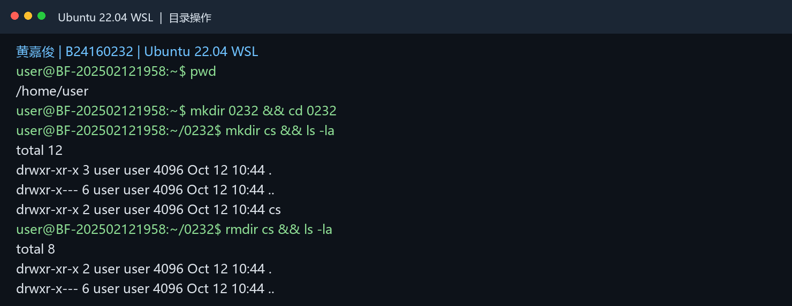

### 三、文件操作

已使用本人姓名和学号末四位：

```bash
cd ~
touch 黄嘉俊.txt
ls
echo "hello world" > 0232.txt
cat 0232.txt
cp 黄嘉俊.txt 0232_copy.txt
mv 黄嘉俊.txt 0232_newname.txt
ls
```

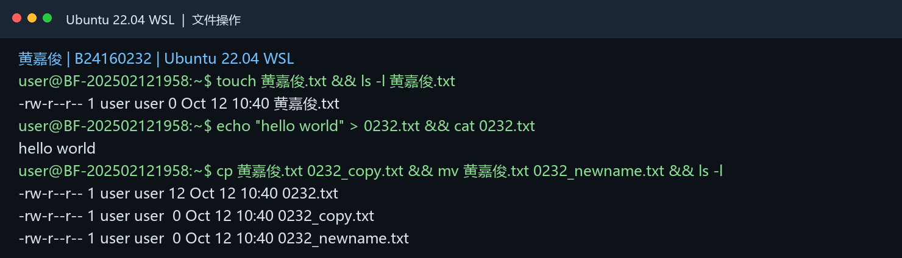

### 四、用户管理

按学号末四位创建用户 `NY0232` 并加入 `student` 组。WSL 默认账户没有可用的 sudo 密码，因此管理员操作在 WSL root 会话中执行；使用 `useradd -g student` 一步完成建用户和分组，等效实现题目中的 `adduser` 与 `usermod`。截图保留实际命令和 root 提示符。新用户未设置登录密码。

```bash
groupadd -f student
useradd -m -g student -s /bin/bash NY0232
id NY0232
su - NY0232 -c 'touch ~/NY0232.txt && ls -l ~/NY0232.txt'
```

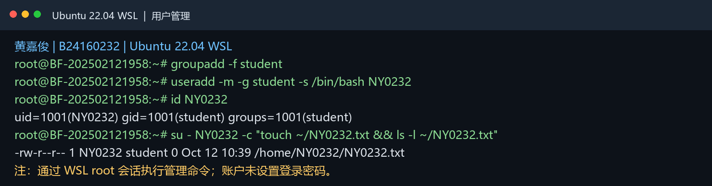

### 五、权限管理

依次执行以下命令；每行 `chmod` 后都运行 `ls -l demo` 查看权限变化：

```bash
touch demo
chmod 777 demo
ls -l demo
chmod a-x demo
ls -l demo
chmod go-w demo
ls -l demo
chmod g+w demo
ls -l demo
chmod a= demo
ls -l demo
chmod +t demo
ls -l demo
chmod u+s demo
ls -l demo
chmod u+rx demo
ls -l demo
chmod g+rws demo
ls -l demo
```

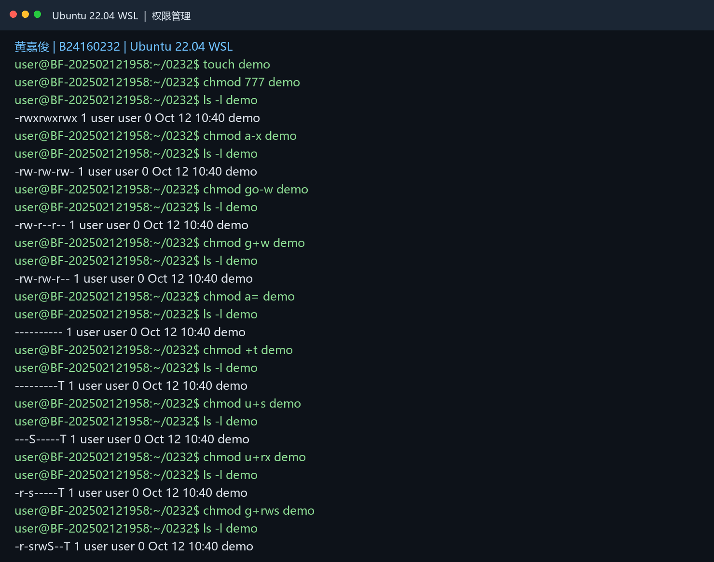

### 六、归档、解压与文本搜索

在用户主目录下创建 `others` 文件夹，在其中创建任意两个文件。回到主目录后执行：

```bash
cd ~
mkdir -p others
cd others
touch file1 file2
cd ~
tar -czvf backup.tar.gz others
ls -l
tar -xzvf backup.tar.gz
ls -l
```

创建名为 `textfile` 的文本文件，并按实验要求写入以下内容：

```text
no, I study in njup.
this line ends with 00
this line ends with .00
I am 25 years old.
He is 15. It is 16.00
wy is the short of my name.
```

使用 `grep` 完成指定搜索：

```bash
grep '^n' textfile
grep '\.00$' textfile
grep '5\..' textfile
grep '^[wy]' textfile
```

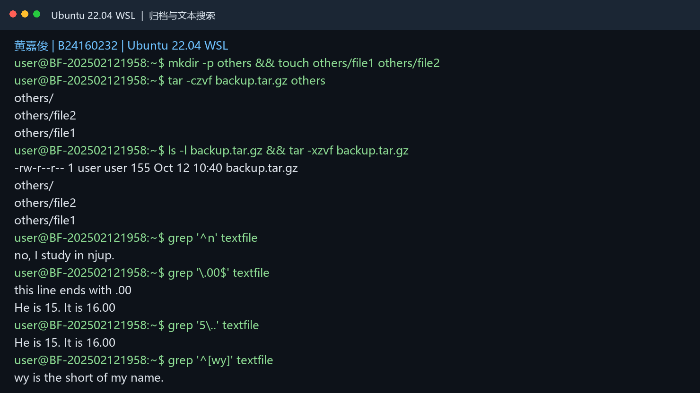

## 课堂服务器搭建任务记录

以下包含两类材料：课堂照片用于记录教师演示；WSL 运行结果图由 Ubuntu 22.04 中实际执行的命令和输出整理导出。

### 七、OpenSSH Server

**目标：**安装 SSH 服务，并从 Windows 端通过 SSH 客户端连接 Linux 虚拟机。

课堂步骤摘要：安装 `openssh-server`；使用 `ifconfig` 查看虚拟机 IP；在 PuTTY、Xshell 或 SecureCRT 中选择 SSH、端口 22 并连接；在远程终端执行基本命令验证连接。

**课堂演示照片：**

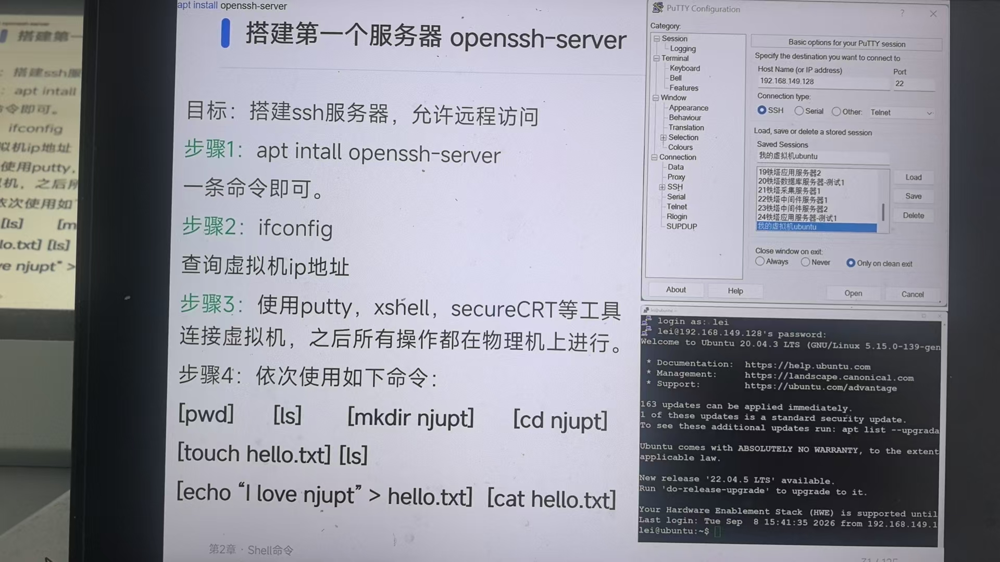

**本人 WSL 完成截图：服务已启动并监听 22 端口；SSH 密钥登录返回用户名和主机名。**

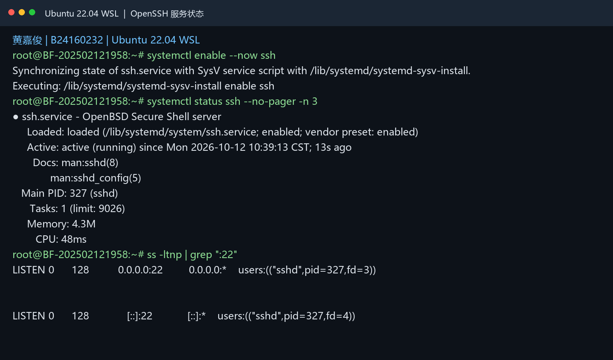

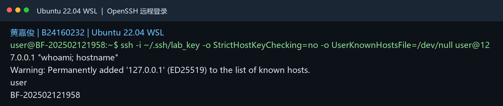

### 八、Nginx Web Server

**目标：**安装 Nginx 并通过浏览器访问 Web 服务。

课堂步骤摘要：安装 `nginx`；使用 `ifconfig` 查询虚拟机 IP；浏览器访问该 IP 验证 Nginx 页面；按课堂要求在 `/var/www/html` 创建或编辑 `index.html`，写入个人测试内容并再次访问验证。

**课堂演示照片：**

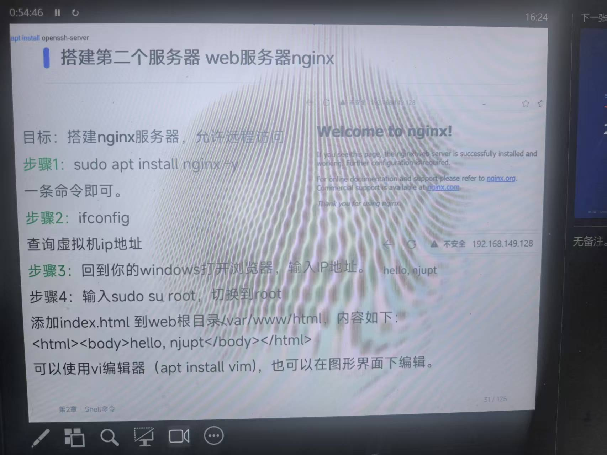

**本人 WSL 完成结果：Nginx 服务处于 active (running)，`curl http://127.0.0.1` 返回个人测试页面。本次验证了 WSL 内部访问，未验证 Windows 主机的端口转发。**

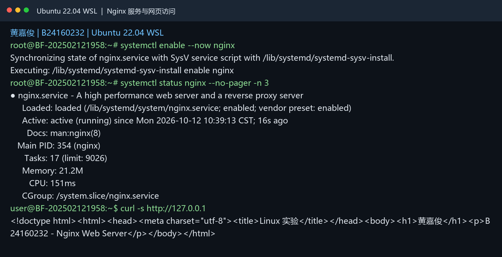

### 九、MySQL Server

**目标：**安装 MySQL Server，创建数据库和本地用户，并验证数据库可用。

课堂步骤摘要：安装 `mysql-server`；用 `systemctl status mysql` 查看服务状态；进入 MySQL 后按课堂练习创建 `mydb` 数据库及 `myuser@localhost` 用户，授权并用 `SHOW DATABASES;` 验证；退出后可按课程演示使用数据库客户端连接本机服务。

```sql
CREATE DATABASE mydb CHARACTER SET utf8mb4 COLLATE utf8mb4_unicode_ci;
CREATE USER 'myuser'@'localhost' IDENTIFIED BY '111111';
GRANT ALL PRIVILEGES ON mydb.* TO 'myuser'@'localhost';
FLUSH PRIVILEGES;
SHOW DATABASES;
```

课堂照片仅展示任务步骤。本人已启动 MySQL，创建 `mydb` 和 `myuser@localhost`，并验证该用户可以查询数据库。密码 `111111` 仅用于本机课程练习。

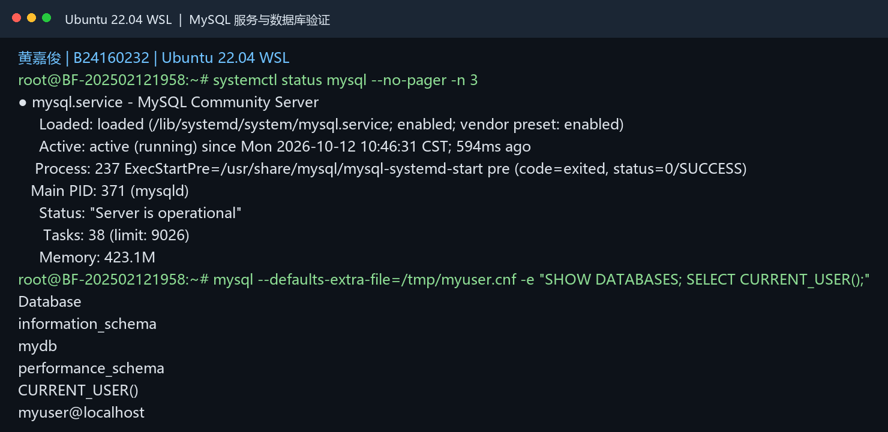

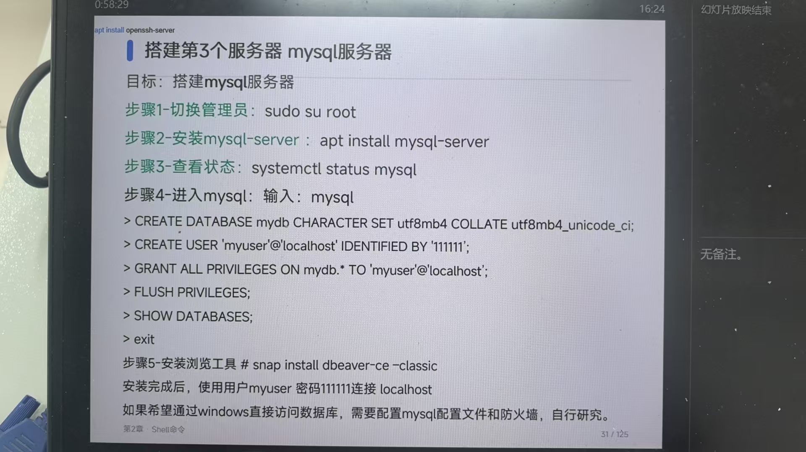

## 提交前检查

- [x] 已填写姓名、学号和学号末四位 0232；班级信息未提供。
- [x] 已执行实验一及 OpenSSH、Nginx、MySQL 操作，并加入 WSL 实际运行结果图。
- [x] 已检查图片引用和 PDF 排版；MySQL 密码未出现在运行结果图中。

